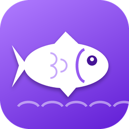

<p align="center">
  
</p>

<h1 align="center">fisher's friend</h1>

<p align="center">
  Seu auxiliar de pesca para o chat da Twitch.<br>
  Pesca, embarca em frotas, aceita duelos e aproveita eventos por você.
</p>

---

## O que ele faz

O programa entra no chat de um canal usando a **sua conta** e reage às mensagens do bot de jogo (feito para o **TwishGameBot**), enviando os comandos certos na hora certa:

| Situação no chat | O que o programa envia |
|---|---|
| Passou o cooldown da sua vara | `$pescar` |
| Uma frota foi aberta | `$embarcar` |
| A frota zarpou e citou o seu nick | `$pescar` (cooldown resetado) |
| Algum evento resetou o cooldown | `$pescar` |
| Maré turbo começou | `$pescar` + cooldown pela metade por 10 min |
| Venda turbinada começou | `$vender todos` |
| Sua mochila encheu | `$vender todos` e depois `$pescar` |
| Um torneio foi aberto | `$entrar` e depois `$pescar` |
| Alguém te desafiou para um duelo | `$aceitar` |
| Seu duelo foi confirmado | `$pescar` |

Detalhes que ele respeita:

- **Expedição:** quando uma frota zarpa com você, a maré turbo não vale por 30 minutos. O programa anula a que estava ativa e ignora as que começarem durante a expedição.
- **Só reage ao que é seu:** frota que zarpou sem você, mochila cheia de outra pessoa e duelos de terceiros são ignorados.
- **Sem repetição:** cada evento tem um tempo mínimo entre envios, para não mandar o mesmo comando duas vezes.
- **Pequenos atrasos aleatórios** entre as mensagens, para não enviar tudo no mesmo instante.

## Como usar

> Funciona no **Windows**. Não precisa instalar Python.

1. Baixe o `FishersFriend.exe` na página de [**Releases**](../../releases).
2. Abra o programa.
   Se o Windows mostrar *"O Windows protegeu o computador"*, clique em **Mais informações** e depois em **Executar assim mesmo**. Isso acontece com qualquer programa novo sem assinatura digital.
3. Clique em **Entrar com a Twitch**. O navegador abre, você entra na sua conta e clica em **Ativar**. Não precisa copiar token nenhum.
4. Digite o **canal** onde quer pescar e confira o **nome do bot** do canal.
5. Escolha a **vara** que você está usando.
6. Clique em **Conectar**.

O log da direita mostra o que foi enviado (em verde), o chat (em cinza) e avisos (em roxo ou vermelho).

### Varas e cooldowns

Ao escolher a vara, o intervalo entre as pescas muda sozinho.

| Vara | Cooldown |
|---|---|
| Vara de bambu | 10 min |
| Vara de madeira reforçada | 9 min |
| Vara de fibra de vidro | 8 min |
| Vara de aço | 7 min |
| Vara de carbono | 6 min |
| Vara encantada | 5 min |
| Vara abissal | 4 min |
| Vara lendária | 3 min |
| Vara njord | 2 min |

Também dá para marcar **Personalizado** e digitar o cooldown em segundos.

## Login e privacidade

- O login é o **oficial da Twitch** (autorização por código no navegador). O programa nunca vê a sua senha.
- As permissões pedidas são apenas **ler e enviar mensagens no chat** (`chat:read` e `chat:edit`).
- O token fica **só no seu computador**, em `%APPDATA%\FishersFriend\config.json`. Ele não vai junto com o programa e não é enviado para ninguém além da Twitch.
- O token é renovado automaticamente. Se você ficar cerca de 30 dias sem usar, o programa pede um novo login.
- Para sair, use o botão **Sair da conta**: ele apaga os dados do computador e revoga o acesso na Twitch. Você também pode remover o acesso a qualquer momento em [twitch.tv/settings/connections](https://www.twitch.tv/settings/connections).

## Problemas comuns

| Problema | O que fazer |
|---|---|
| Não consigo entrar | Confira se o navegador abriu a página da Twitch e se você clicou em **Ativar**. O código tem tempo limitado, então tente de novo se demorar. |
| "Login recusado" no log | Clique em **Sair da conta** e entre de novo. |
| Conectou, mas não envia nada | Ligue **Mostrar chat** e confira se o nome do bot e o canal estão certos. |
| Frota zarpou e não pescou | Veja o log: ele diz se o seu nick não apareceu na mensagem ou se o anti-spam segurou o envio. |
| O antivírus apagou o `.exe` | É um falso positivo comum em programas feitos com PyInstaller. Adicione o arquivo às exceções. |
| Mensagem enviada mas o jogo não respondeu | A Twitch descarta mensagens idênticas enviadas em menos de 30 segundos. Procure uma linha `TWITCH: ... NOTICE` no log. |

## Para quem quer rodar pelo código

Precisa de **Python 3.8 ou mais novo** (o Tkinter já vem junto). Não há dependências extras.

```
python pescar_gui.py
```

### Gerar o `.exe`

```
python -m pip install pyinstaller
python -m PyInstaller --onefile --noconsole --clean --name FishersFriend --icon icone.ico --add-data "icone.ico;." pescar_gui.py
```

O programa fica em `dist\FishersFriend.exe`.

### Ajustar as mensagens do bot

Se o bot mudar o texto de algum evento, as palavras-chave ficam no topo do `pescar_gui.py`, na seção **Palavras-chave**. Valores como o comando de venda, a lista de eventos que resetam o cooldown e a duração da expedição ficam na seção **Configuração**.

### Usar o seu próprio app da Twitch

Se você fizer um fork, registre um app em [dev.twitch.tv/console](https://dev.twitch.tv/console) com **Client Type: Public** e troque o `CLIENT_ID` no começo do arquivo. O Client ID não é secreto. Nunca coloque um token no código.

## Estrutura

```
pescar_gui.py   programa completo (interface, login e lógica)
icone.ico       ícone do programa
icone.png       imagem usada neste README
.gitignore      impede que config.json, dist/ e build/ subam por engano
```

## Avisos

- Este projeto é **independente** e não tem relação com a Twitch nem com o TwishGameBot.
- Automatizar comandos pode ser proibido nas regras de alguns canais ou jogos. O uso é de sua responsabilidade e pode resultar em punições na sua conta.